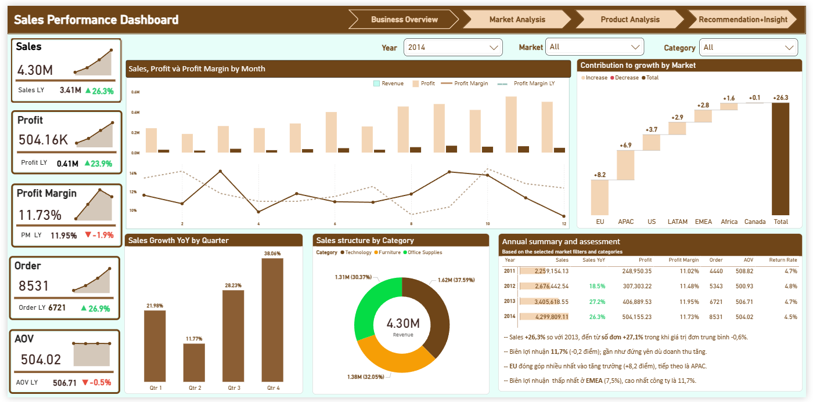
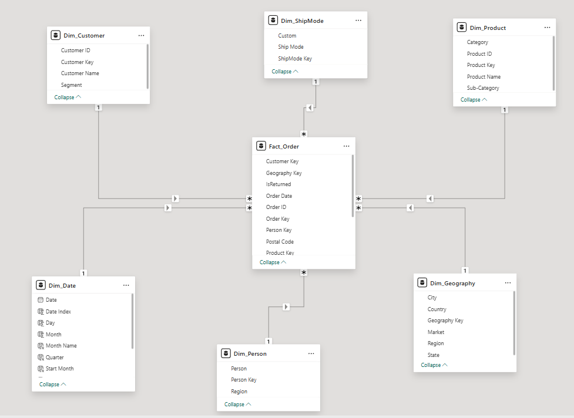
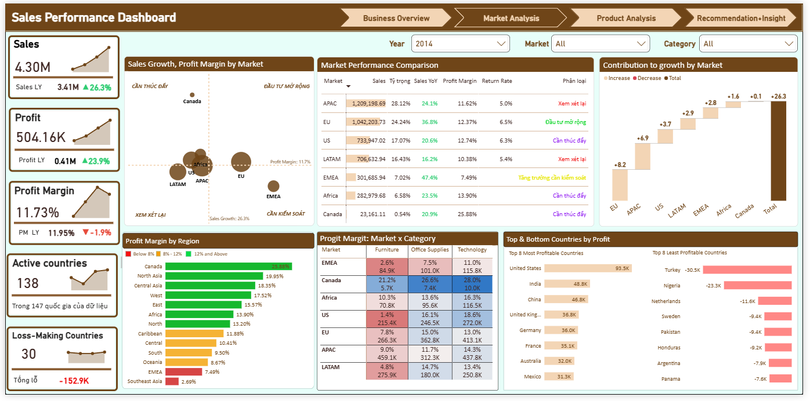
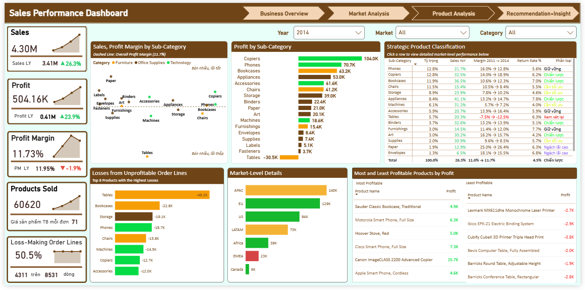
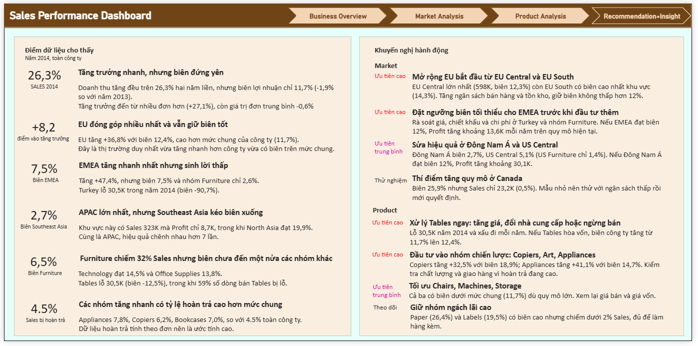

# 📊 Which Markets to Expand & Which Products to Prioritize – Global Superstore | Power BI

_Market expansion and product strategy analysis for a fast-growing multi-category retailer._

- **Business question:** Superstore is growing fast and wants to expand its market share. Which markets should it expand into, and which product groups should it prioritize, without sacrificing profit margin?
- **Domain:** Retail / multi-category e-commerce (7 markets, 147 countries)
- **Tools:** Power BI (Power Query, star schema, DAX, dashboard design)

---

## 📑 Table of Contents

1. [📌 Background & Overview](#-background--overview)
2. [📂 Dataset Description & Data Structure](#-dataset-description--data-structure)
3. [🧠 Design Thinking Process](#-design-thinking-process)
4. [📊 Key Insights & Visualizations](#-key-insights--visualizations)
5. [🔎 Final Conclusion & Recommendations](#-final-conclusion--recommendations)

---

## 📌 Background & Overview

### 📖 What is this project about?

Superstore's revenue nearly doubled between 2011 and 2014, but growth does not automatically mean healthy profit. This project builds a 4-page Power BI dashboard (**Overview**, **Markets**, **Products**, **Recommendations & Insights**, with filters for year, market and product category) that answers three questions:

✔️ How is the business performing overall: is growth coming with healthy margins?
✔️ How are the individual markets and regions performing, and which ones deserve expansion investment?
✔️ How are the product groups performing, and which ones are strategic versus loss-making?

### 👤 Who is this project for?

✔️ **Senior Manager** deciding where to expand and which products to prioritize (primary user)
✔️ Regional sales managers responsible for each Market/Region
✔️ Category and pricing teams managing product mix and discounts

---

## 📂 Dataset Description & Data Structure

### 📌 Data Source

- **Source:** Global Superstore sample dataset ([`Dataset/`](Dataset/))
- **Size:** 3 tables. Orders: 51,290 rows × 20 columns; People: 13 rows; Returns: 1,172 rows. Covers 25,035 Order IDs, 1,590 customers, 147 countries, 7 Markets, 13 Regions, 3 Categories, 17 Sub-Categories and 10,292 product IDs
- **Period:** 2011 – 2014
- **Format:** .csv

### 📊 Data Structure & Relationships

#### 1️⃣ Table Schema & Data Snapshot

All three tables are used:

| Table | Size | Content |
|---|---|---|
| **Orders** | 51,290 rows × 20 columns | One row per product line in an order: order/ship dates, ship mode, customer, Segment, geography (Market, Region, Country, State, City), product (Category, Sub-Category), Sales, Quantity, Profit |
| **People** | 13 rows × 2 columns | The salesperson responsible for each Region |
| **Returns** | 1,172 rows × 2 columns | Order IDs that were returned (the `Returned` column only contains "Yes") |

<details>
<summary>Model tables after transformation (click to expand)</summary>

| Table | Grain | Rows |
|---|---|---|
| `Fact_Sales` | One product line in one order | 51,281 |
| `Dim_Date` | One day | 1,826 |
| `Dim_Customer` | One customer | 1,590 |
| `Dim_Product` | One (Product ID, Product Name) pair | 10,768 |
| `Dim_Geography` | One (Market, Region, Country, State, City) combination | 3,819 |
| `Dim_ShipMode` | One ship mode | 4 |
| `Dim_Salesperson` | One salesperson per Region | 13 |

</details>

#### 2️⃣ Data Relationships

Star schema with `Fact_Sales` at the center and 6 dimension tables.



---

## 🧠 Design Thinking Process

| Step | Content |
|---|---|
| 1️⃣ **Empathize** | The Senior Manager sees revenue growing fast and wants to expand, but has no clear view of which markets and products actually earn money. |
| 2️⃣ **Define point of view** | Growth must be judged together with margin. Three questions: overall performance, market performance, product performance. Key metrics: Sales, Profit, Profit Margin %, Orders, AOV, YoY growth and growth contribution by market. |
| 3️⃣ **Ideate** | One page per question plus a recommendations page. Each page has three tiers: **most important** (KPI cards and main chart on top), **important** (middle) and **detail** (bottom or drill-down). Key visuals: Growth × Margin bubble chart for markets, Sales × Margin scatter for Sub-Categories, waterfall of growth contribution. |
| 4️⃣ **Prototype and review** | Totals of Sales, Profit and Quantity were reconciled against the source after every cleaning step, then the dashboard was tested and published. |

## ⚒️ Main Process

1️⃣ **Data Exploration & Cleaning (Power Query)**

| # | Issue | Treatment |
|---|---|---|
| 1 | 9 rows duplicated across all 20 columns | Removed (reduces Sales by 1,478 and Profit by 159); assumed to be double entry |
| 2 | `Order ID` is reused across different orders (659 IDs) | Created `OrderKey` = Order ID + Customer ID + Order Date, giving **25,754 real orders** |
| 3 | Region `AMEA` (People) does not match `EMEA` (Orders) | Standardized to `EMEA` so the join works |
| 4 | Region names repeat across Markets (`Central`, `North`, `South`) | Added a `Market_Region` column and a warning flag |
| 5 | Austria and Mongolia belong to two different Markets | Kept as in the source, flagged with `CountryInMultipleMarkets` |
| 6 | One `Product ID` maps to several product names (457 IDs) | Product table at (ID + Name) level; main analysis at Sub-Category level |
| 7 | Dates stored as M/D/YYYY text | Converted to dates; continuous date table 2011–2015 |
| 8 | 16 product names with extra whitespace | Trimmed |
| 9 | `Postal Code` exists only for the US (41,296 blank rows) | Dropped from the model |
| 10 | `Returns` contains only Order IDs | Joined into the fact table as `IsReturned`; 29 ambiguous matches flagged `ReturnMatchAmbiguous` |

2️⃣ **DAX Measures** (key examples)

```DAX
Sales = SUM ( Fact_Sales[Sales] )

Orders = DISTINCTCOUNT ( Fact_Sales[OrderKey] )

Profit Margin % = DIVIDE ( [Profit], [Sales] )

Sales PY =
IF (
    DISTINCTCOUNT ( Dim_Date[Year] ) = 1,
    CALCULATE ( [Sales], SAMEPERIODLASTYEAR ( Dim_Date[Date] ) )
)

Sales YoY % = DIVIDE ( [Sales] - [Sales PY], [Sales PY] )

Growth Contribution Market (pp) =
DIVIDE (
    [Sales] - [Sales PY],
    CALCULATE ( [Sales PY], ALL ( Dim_Geography ) )
)
```

3️⃣ **Power BI Visualization**

| Page | Main content |
|---|---|
| **1. Overview** | 8 KPI cards (Sales, Profit, Margin, Orders, AOV, Customers, Returns, Loss-making lines); Sales, Profit and margin by month; waterfall of growth contribution by market; Sales YoY by quarter; category mix; yearly summary |
| **2. Markets** | Growth × Margin bubble chart (four decision groups); market comparison table; waterfall; margin by region; Market × Category heatmap; most and least profitable countries |
| **3. Products** | Sales × Margin scatter by Sub-Category; Profit by Sub-Category; strategic product classification; losses from loss-making lines; drill-down by market; most and least profitable products |
| **4. Recommendations & Insights** | What the data shows, recommendations by priority, illustrative scenarios, data limitations, next steps |

- Power BI file: [`Dashboard/Global_Superstore_Dashboard.pbix`](Dashboard/Global_Superstore_Dashboard.pbix)
- PDF version: [`Dashboard/Global_Superstore_Dashboard.pdf`](Dashboard/Global_Superstore_Dashboard.pdf)

---

## 📊 Key Insights & Visualizations

### 🔍 Dashboard Preview

Figures compare 2014 with 2013, whole company.

#### 1️⃣ Business Overview


📌 Analysis 1:
- **Observation:** In 2014 Superstore reached **Sales of 4.30M** (+26.3%) and **Profit of 504K** (+23.9%); revenue nearly doubled from 2.26M in 2011. But **profit margin barely moved** at 11.7% (−0.2 points). Growth came from **more orders** (8,868, +28.7%) while average order value fell slightly (485, −1.9%).
- **Recommendation:** Growth is volume-driven, not margin-driven. Expansion decisions should be filtered by margin, not by revenue growth alone.

#### 2️⃣ Market Analysis



📌 Analysis 2:
- **Observation:** **EU contributed the most to growth** (+8.2 points) with a 12.4% margin, and is the only market that both grew faster than the company (+36.8%) and had a margin above the company level. **EMEA grew the fastest** (+47.4%) but at only **7.5%** margin; Turkey lost about 30.5K in 2014. **Canada** has the highest margin (25.9%) but only 0.5% of revenue. Within APAC (the largest market, 28.1% of Sales), **Southeast Asia** earns just **2.7%** margin while North Asia reaches 19.9%.
- **Recommendation:** Expand in EU first (starting with EU Central and EU South). Set a minimum margin threshold for EMEA (review pricing and discounts in Turkey) before investing more. Fix profitability in Southeast Asia. Pilot a small scale-up in Canada.

#### 3️⃣ Product Analysis



📌 Analysis 3:
- **Observation:** **Furniture** is 32% of Sales but earns only **6.5%** margin, versus 14.5% for Technology and 13.8% for Office Supplies. **Tables** is the only loss-making Sub-Category (−30.5K, margin −12.5%), with about 59% of its sales lines at a loss; if Tables broke even, company margin would rise from 11.7% to about 12.4%. **Strategic groups**: Copiers (+32.5%, 18.9% margin), Appliances (+41.1%, 14.7%), Bookcases, Binders and Art, though they have above-average return rates. About **24.6% of sales lines make a loss**, totaling roughly 310K, equal to 62% of the year's Profit.
- **Recommendation:** Act on Tables now (raise prices, change supplier or discontinue). Invest in Copiers, Art and Appliances while checking quality and delivery because of high returns. Review pricing and cost for low-margin, high-volume groups such as Chairs, Machines and Storage.

#### 4️⃣ Recommendations & Insights



📌 Analysis 4:
- **Observation:** This page summarizes what the data shows and ranks actions by priority (High, Medium, Pilot, Monitor) for both markets and products, each backed by the metric that supports it.
- **Recommendation:** Use this page as the decision brief for the Senior Manager and track the listed metrics after each action.

---

## 🔎 Final Conclusion & Recommendations

👉🏻 Based on the insights above, we recommend the **Senior Manager** consider the following:

📌 Key Takeaways:
✔️ **Expand where growth and margin go together: EU first.** It is the largest growth contributor (+8.2 points) with a margin above the company level.
✔️ **Fix before you grow in EMEA and Southeast Asia.** Both grow or sell a lot but at thin margins (7.5% and 2.7%); set a margin floor before adding investment.
✔️ **Stop the bleeding in Tables and loss-making lines.** Tables alone loses 30.5K; loss-making lines cost about 62% of yearly profit.
✔️ **Prioritize strategic products: Copiers, Appliances, Art**, while addressing their higher return rates.

**Limitations:**
- No discount or shipping cost fields, so the data cannot explain *why* Tables or EMEA lose money; pricing and discount recommendations are hypotheses to test.
- Returns data is incomplete (Africa, EMEA and Canada have no returned orders) and attached at order level, so product-level return rates are overestimates.
- `Order ID` is reused across orders, so orders are counted with a composite key; 29 returned Order IDs match more than one real order.
- Salesperson mapping joins only by Region name, so salesperson analysis is for reference only.
- Product IDs and names do not fully match (457 IDs map to several names), so the main analysis is at Sub-Category level.
