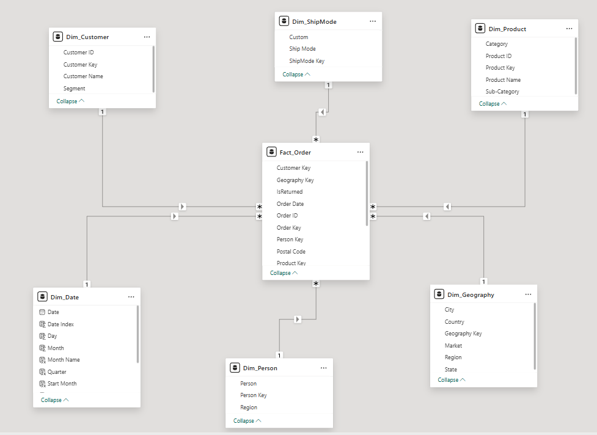
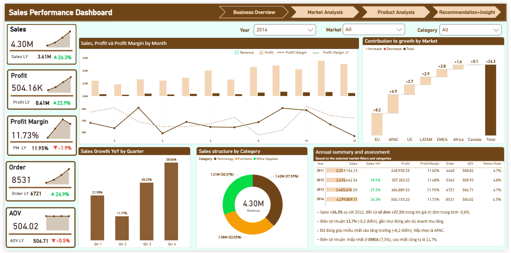
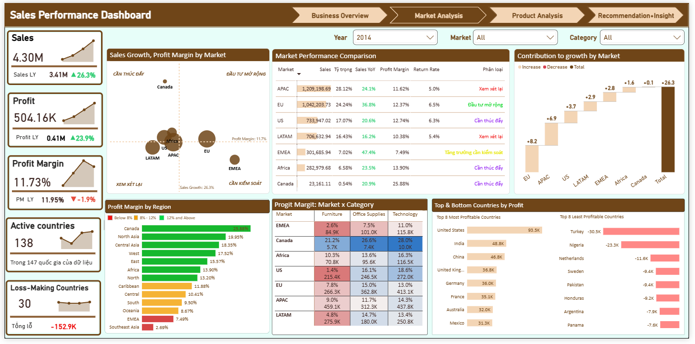
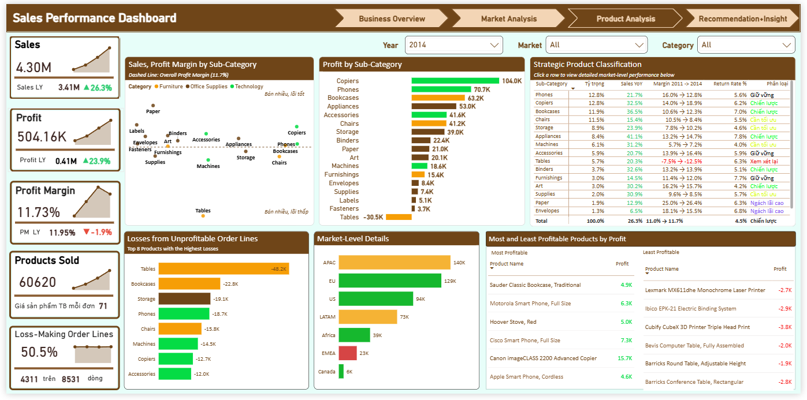
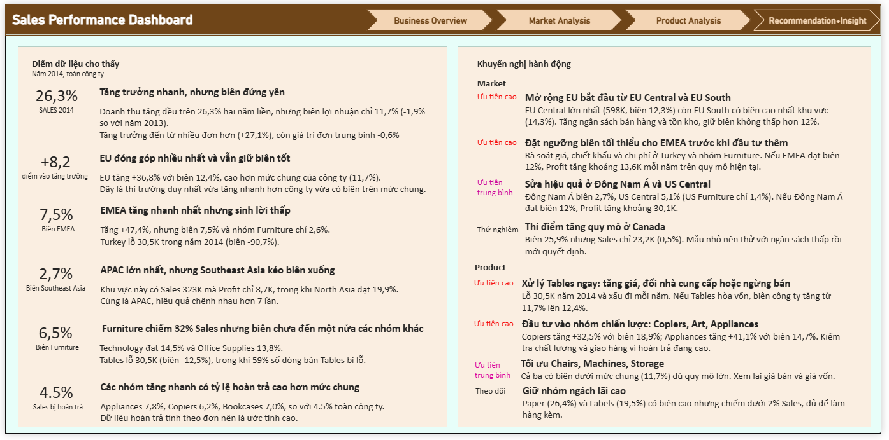

# Superstore: Global Sales Analysis | Power BI Dashboard

## Overview

This project analyzes the global sales data of **Superstore**, a multi-category retailer that is growing fast and wants to expand its market share. The goal is to help a **Senior Manager** decide which markets to expand into and which products to prioritize, through a dashboard that answers three questions:

1. How is the business performing overall?
2. How are the individual markets performing?
3. How are the product groups performing?

The dashboard has 4 pages: **Overview**, **Markets**, **Products** and **Recommendations & Insights**. The interactive version has filters for year, market and product category 

## Table of Contents

- [Dataset](#dataset)
- [Methodology](#methodology)
- [Executive Summary](#executive-summary)
- [Limitations](#limitations)

## Dataset

The data comes in three tables:

| Table | Size | Content |
|---|---|---|
| **Orders** | 51,290 rows × 20 columns | One row per product line in an order: order/ship dates, ship mode, customer, Segment, geography (Market, Region, Country, State, City), product (Category, Sub-Category), Sales, Quantity, Profit |
| **People** | 13 rows × 2 columns | The salesperson responsible for each Region |
| **Returns** | 1,172 rows × 2 columns | Order IDs that were returned (the `Returned` column only contains "Yes") |

Overall scale: 25,035 Order IDs, 1,590 customers, 147 countries, 7 Markets, 13 Regions, 3 Categories, 17 Sub-Categories and 10,292 product IDs.

## Methodology

The process was: Explore and clean the data, design the data model, write the DAX, design the dashboard, then test and publish.

### 1. Data exploration and cleaning

The data was read in Python, and total Sales, Profit and Quantity were reconciled against the source after each step.

| # | Issue | Treatment |
|---|---|---|
| 1 | 9 rows duplicated across all 20 columns | Removed (reduces Sales by 1,478 and Profit by 159); assumed to be double entry |
| 2 | `Order ID` is reused across different orders (659 IDs) | Created `OrderKey` = Order ID + Customer ID + Order Date, giving **25,754 real orders** (counting by Order ID alone gives 25,035) |
| 3 | Region `AMEA` (People) does not match `EMEA` (Orders) | Standardized to `EMEA` so the join works |
| 4 | Region names repeat across Markets (`Central`, `North`, `South`) | Added a `Market_Region` column and a warning flag in the geography table |
| 5 | Austria and Mongolia belong to two different Markets | Kept as in the source and flagged with `CountryInMultipleMarkets` |
| 6 | One `Product ID` maps to several product names (457 IDs) | Product table is at (ID + Name) level; main analysis is at Sub-Category level |
| 7 | Dates stored as M/D/YYYY text | Converted to dates and created a continuous date table for 2011 to 2015 |
| 8 | 16 product names with extra whitespace | Trimmed |
| 9 | `Postal Code` exists only for the US (41,296 blank rows) | Dropped from the model because it does not serve the three questions |
| 10 | `Returns` contains only Order IDs | Joined into the Fact table as an `IsReturned` flag; 29 returned Order IDs that match several real orders are flagged `ReturnMatchAmbiguous` |

### 2. Data model (star schema)



| Table | Grain | Rows |
|---|---|---|
| `Fact_Sales` | One product line in one order | 51,281 |
| `Dim_Date` | One day | 1,826 |
| `Dim_Customer` | One customer | 1,590 |
| `Dim_Product` | One (Product ID, Product Name) pair | 10,768 |
| `Dim_Geography` | One (Market, Region, Country, State, City) combination | 3,819 |
| `Dim_ShipMode` | One ship mode | 4 |
| `Dim_Salesperson` | One salesperson per Region | 13 |


### 3. DAX measures

The full set is in `Superstore_DAX_Measures.dax`. Key measures:

```DAX
Sales = SUM ( Fact_Sales[Sales] )

Orders = DISTINCTCOUNT ( Fact_Sales[OrderKey] )

Profit Margin % = DIVIDE ( [Profit], [Sales] )

Sales PY =
IF (
    DISTINCTCOUNT ( Dim_Date[Year] ) = 1,
    CALCULATE ( [Sales], SAMEPERIODLASTYEAR ( Dim_Date[Date] ) )
)

Sales YoY % = DIVIDE ( [Sales] - [Sales PY], [Sales PY] )

Growth Contribution Market (pp) =
DIVIDE (
    [Sales] - [Sales PY],
    CALCULATE ( [Sales PY], ALL ( Dim_Geography ) )
)
```

### 4. Dashboard design

Each page splits information into three tiers: **most important** (KPI cards and the main chart at the top), **important** (middle) and **detail** (bottom or drill-down).

| Page | Main content |
|---|---|
| **1. Overview** | 8 KPI cards (Sales, Profit, Margin, Orders, AOV, Customers, Returns, Loss-making lines); Sales, Profit and margin by month; waterfall of growth contribution by market; Sales YoY by quarter; category mix; yearly summary table |
| **2. Markets** | Growth × Margin bubble chart by market (four decision groups); market comparison table; waterfall; margin by region; Market × Category heatmap; most and least profitable countries |
| **3. Products** | Sales × Margin scatter by Sub-Category; Profit by Sub-Category; strategic product classification table; losses from loss-making lines; drill-down by market; most and least profitable products |
| **4. Recommendations & Insights** | What the data shows, recommendations by priority, illustrative scenarios, data limitations, next steps |


## Executive Summary

Key insights (2014 vs 2013, whole company):

- In 2014 Superstore reached **Sales of 4.30 million** (+26.3%) and **Profit of 504 thousand** (+23.9%). Between 2011 and 2014, revenue nearly doubled (2.26 million to 4.30 million).
- **Profit margin barely moved** at 11.7% (−0.2 points vs 2013). Growth came from **more orders** (8,868, +28.7%), while average order value fell slightly (485, −1.9%).



- **EU contributed the most to growth** (+8.2 points) with a 12.4% margin, and is the only market that both grew faster than the company (+36.8%) and had a margin above the company level.
- **EMEA grew the fastest** (+47.4%) but with a margin of only **7.5%**; Turkey lost about 30.5 thousand in 2014. **Canada** has the highest margin (25.9%) but only 0.5% of revenue.
- Within APAC (the largest market, 28.1% of Sales), **Southeast Asia** has a margin of just **2.7%**, while North Asia reaches 19.9%.



- **Furniture** is 32% of Sales but earns a margin of only **6.5%**, compared with 14.5% for Technology and 13.8% for Office Supplies. **Tables** is the only Sub-Category making a loss (−30.5 thousand, margin −12.5%), with about 59% of its sales lines at a loss.
- If Tables broke even, the company margin would rise from 11.7% to about 12.4%.
- **Strategic product groups**: Copiers (+32.5%, 18.9% margin), Appliances (+41.1%, 14.7%), Bookcases, Binders and Art. These groups have return rates above the company level (Appliances 12.4%, Copiers 9.0%, Bookcases 8.8% vs 6.9%).
- About **24.6% of sales lines make a loss**, totaling roughly 310 thousand, equal to 62% of the year's Profit.
- The company-wide return rate is 6.9% of revenue, but Africa, EMEA and Canada have no returned orders at all in the data.




## Limitations

Limitations that may affect how reliable the recommendations are:

- The data has **no discount or shipping cost fields**, so it cannot explain why Tables or EMEA lose money. Recommendations about pricing and discounts are hypotheses that need testing.
- **Returns data is incomplete.** Africa, EMEA and Canada have no returned orders, most likely because data is missing. Returns are also attached at order level, not product level, so product-level return rates are overestimates.
- **`Order ID` is reused** across different orders, so orders must be counted with a composite key; 29 returned Order IDs match more than one real order.
- **Salesperson mapping is limited.** The People table joins only by Region name, and Region names repeat across Markets, so salesperson analysis is for reference only.
- **Product-level analysis is less reliable.** Product IDs and names do not fully match (457 IDs map to several names), so the main analysis is at Sub-Category level.

